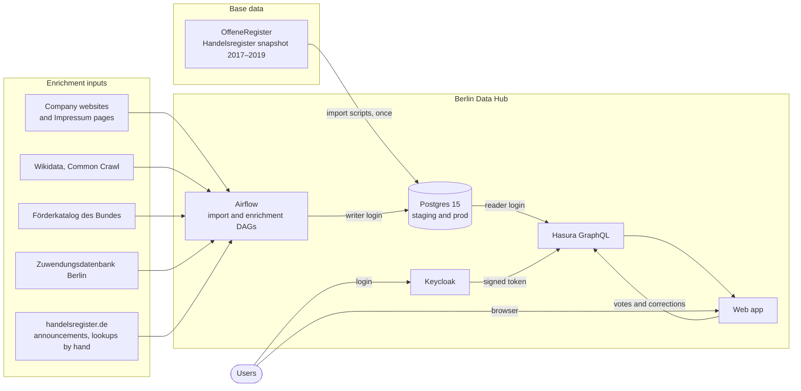
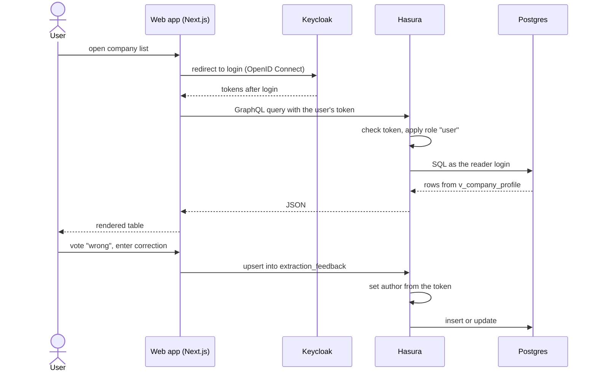
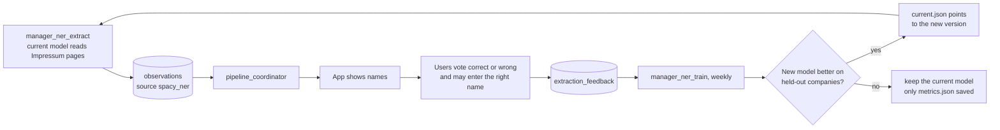

# Unternehmensdatenbank: Architecture Overview

> State on 2026-11-02. The base record of every company is **296,486 Berlin companies from
> OffeneRegister** (a Handelsregister snapshot from 2017–2019); our **Airflow DAGs** add to it and
> check it. Next steps: issue #18.

## 1. Goal

One record per Berlin company with 20 target columns, filled cheaply and traceably: for every value
we know which source said it and why it won over the others.

It runs on the **Berlin Data Hub** (data-hub.berlin), a Kubernetes platform built on CIVITAS/CORE.
We do not deploy there ourselves: we hand over container images, DAGs, migrations and
configuration, and the hub team runs them. Locally, `docker-compose.yml` emulates the hub
([datahub-emulation](datahub-emulation.md)).

## 2. System context

OffeneRegister answers "which companies exist and what was registered about them". Our DAGs add
what it lacks (websites, grants, Technologiefeld, managers from the Impressum) and newer register
facts. The app's users are a source too: votes, corrections and comments. Details per source:
[sources](sources.md).

## 3. Repositories and who runs what

| Piece | Lives in | Runs on |
|---|---|---|
| Database schema (`db/migrations/`, one V1 baseline) | this repo | hub Postgres, via the migration image |
| Pipelines (`airflow/dags/`, `scripts/`) | this repo | hub Airflow; every task a pod from our pipelines image |
| GraphQL API and permissions (`hasura/metadata/`) | this repo | hub Hasura |
| Login realm, local reference (`keycloak/`) | this repo | hub Keycloak |
| Web app | `technologiestiftung/unternehmensdaten-app` | hub, as an image from GHCR |

How images are built and released: [release](release.md).

## 4. How a page request works

The app has no database access of its own. Every read and write goes through Hasura. The author of a
comment or vote always comes from the login token, never from the browser.

## 5. Data, sources and pipelines

Each has its own page, so it is said once:

- How a value is stored and which one wins: [data-model](data-model.md).
- Every source, how we get it, and which column it fills: [sources](sources.md).
- Every DAG and its schedule: [dags](dags.md).

## 6. AI and models

Rules first, small CPU models second, a language model only where judgement over a whole page is
needed. The hub has no GPU.

| Task | Technique today | Next |
|---|---|---|
| Technologiefeld, purpose field | keyword weights; a spaCy text classifier only fills rows no keyword reached (`enrichment/branch_textcat.py`) | keywords run as DAG `technology_field`; the text classifier is trained weekly (`technology_field_train`), promoted only on held-out companies people judged (none yet) |
| Is a page the company's own site | rules: Impressum, register number, name and postcode ([website-verification](website-verification.md)) | |
| Manager names | regular expressions on the Impressum, plus spaCy (`manager_ner`) | weekly training from votes |
| Cluster, DeepTech, isAI | none | labels first, then a text classifier |

A language model is never the only evidence and never used for fields with a fixed format (register
numbers, postcodes, URLs). Its checked answers can become training labels for a small model.

## 7. Feedback loop: training `manager_ner`

| Vote | Meaning for the model |
|---|---|
| most voters say correct | this text is a person name |
| a correction was entered | the corrected text is a person name |
| most voters say wrong | this text is not a person name |
| nobody voted, or a tie | unknown; ignored in training |
| nobody voted, a register officer's name is on the Impressum | this text is a person name (#58) |

- Training continues from the model in use (at first `de_core_news_md`).
- A fifth of the companies is always held out (the same ones every run); only a better F1 score
  there promotes a new model.
- Training starts only with at least 30 companies with usable votes (`MANAGER_NER_MIN_COMPANIES`).
- **Register officers as labels (#58, decided 2026-10-31).** On an Impressum `manager_ner_extract`
  read (from the corpus, nothing downloaded), an officer's name is a positive label; other names
  stay unlabelled, since the register is from 2017-2019. Only companies nobody voted on, never a
  held-out one, at most `MANAGER_NER_MAX_OFFICER_EXAMPLES` (2,000) per run. They add training
  examples; judging stays with people. Measured on 40 local companies: 16 gave an example; of the
  19 officer names on those pages the base model found 13, so 6 are names it misses today.

## 8. The app

| Feature | Detail |
|---|---|
| Company list | all target fields as columns; server-side sorting |
| Filters | name, legal form, register status, Technologiefeld, WZ prefix, with website, with grants; kept in the URL |
| Company page | all fields, grants, comments, votes and corrections |
| Sources page (`/sources`) | per source: records, companies, values stored and shown, latest run |
| Login | Keycloak (OpenID Connect); every request to Hasura carries the user's token |

Running everything locally: [README](../README.md).

## 9. Glossary

| Term | Meaning |
|---|---|
| Observation | one claim by one source about one field of one company |
| Canonical value | the observation that won for a field |
| Priority | rank of a source; the lower number wins, before confidence |
| Technologiefeld | one of Berlin's 77 technology fields, derived from website text |
| WZ | the German industry classification (Wirtschaftszweige) |
| FKZ | Förderkennzeichen, the identifier of one grant |
| DAG | one Airflow pipeline |
| Data Hub | Berlin's urban data platform, CIVITAS/CORE on Kubernetes |
