# Unternehmensdatenbank: Architecture Overview

> State on 2026-10-28. The target setup: the **Fusionbase API** delivers the base record of every
> Berlin company, and our **Airflow DAGs** enrich it. Fusionbase is not connected yet; until it is,
> the example data is **296,486 Berlin companies from OffeneRegister** (a Handelsregister snapshot
> from 2017–2019). Numbers marked "example data" below were measured on the earlier Osnabrück data
> (14,443 companies, removed 2026-10-28). The next steps are in issue #18.

## 1. Goal

One record per Berlin company with 20 target columns, filled cheaply and traceably: for every value
we know which source said it and why it won over the others.

The project runs on the **Berlin Data Hub** (data-hub.berlin), a Kubernetes platform built on
CIVITAS/CORE and operated by the Technologiestiftung with a service provider. We do not deploy
there ourselves. We hand over container images, Airflow DAGs, database migrations and
configuration, and the hub team runs them.

## 2. System context

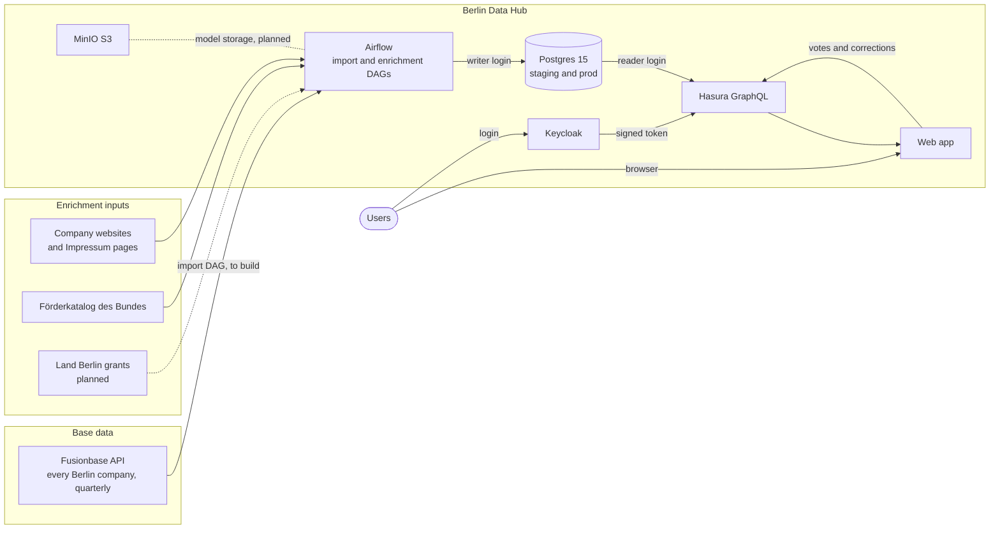

Two layers: Fusionbase answers "which companies exist and what is registered about them"; our DAGs
add what Fusionbase does not deliver (grants, Technologiefeld, classifications) and check what it
does deliver (websites, AI-written WZ codes and descriptions). The fourth source is the app's users:
votes, corrections and comments. Dashed lines are planned. Inputs used only on the Osnabrück example
data are listed in section 8, not here.

## 3. Repositories and who runs what

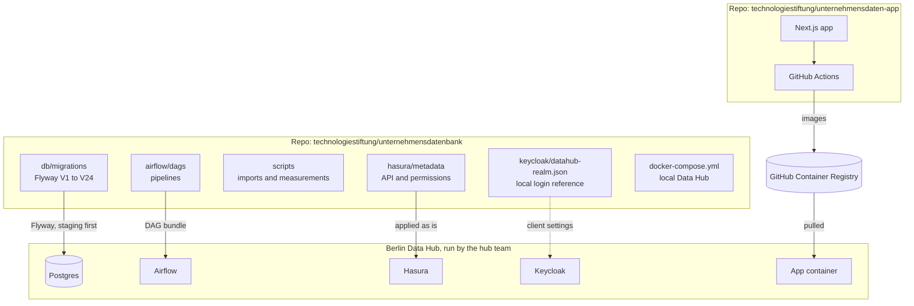

| Piece | Lives in | Runs on |
|---|---|---|
| Database schema (migrations V1 to V24) | data repo, `db/migrations/` | hub Postgres, once per environment |
| Pipelines (Airflow DAGs, scripts) | data repo, `airflow/dags/`, `scripts/` | hub Airflow |
| GraphQL API and permissions | data repo, `hasura/metadata/` | hub Hasura |
| Login realm (local reference) | data repo, `keycloak/` | hub Keycloak |
| Web app | app repo | hub, as a container image from GHCR |
| Platform services | Data Hub team | hub |

## 4. How a page request works

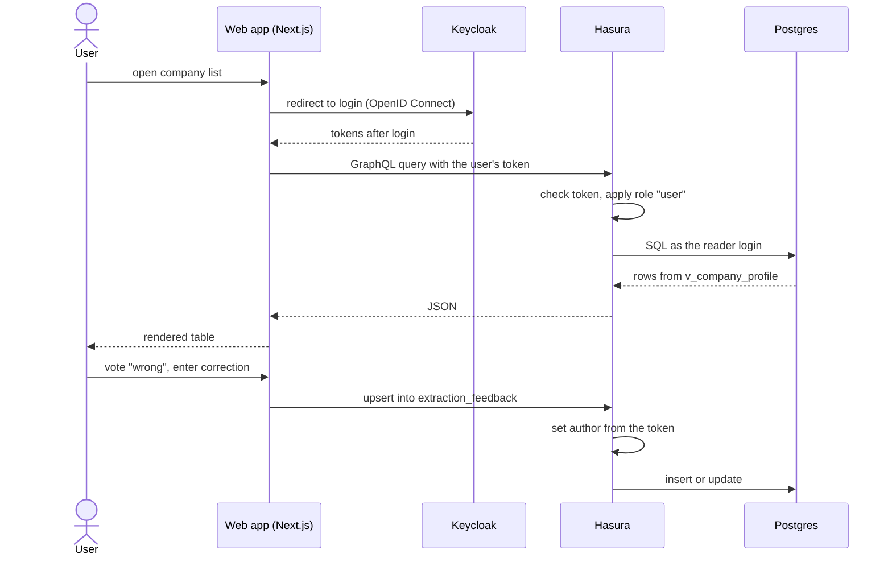

The app has no database access of its own. Every read and write goes through Hasura, which decides
what a signed-in user may do. The author of a comment or vote always comes from the login token,
never from the browser.

## 5. Data model

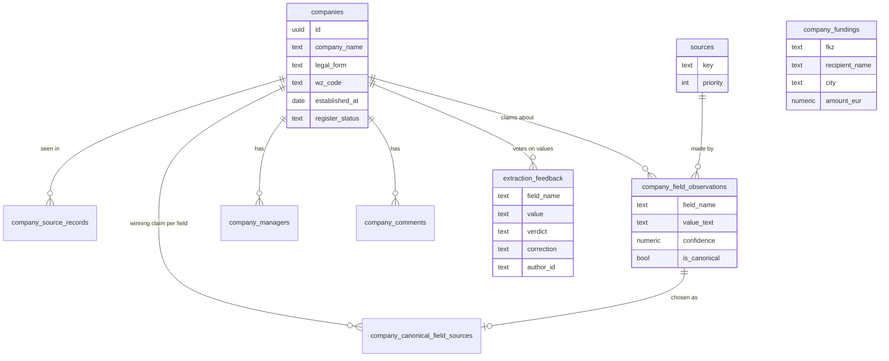

Grants (`company_fundings`) have no company id on purpose: the Förderkatalog has no register
number, so `v_company_fundings` links them on read (same normalised name and city, and that name
unique in the city). An ambiguous name links to nobody rather than to the wrong company.

### From claims to the shown value

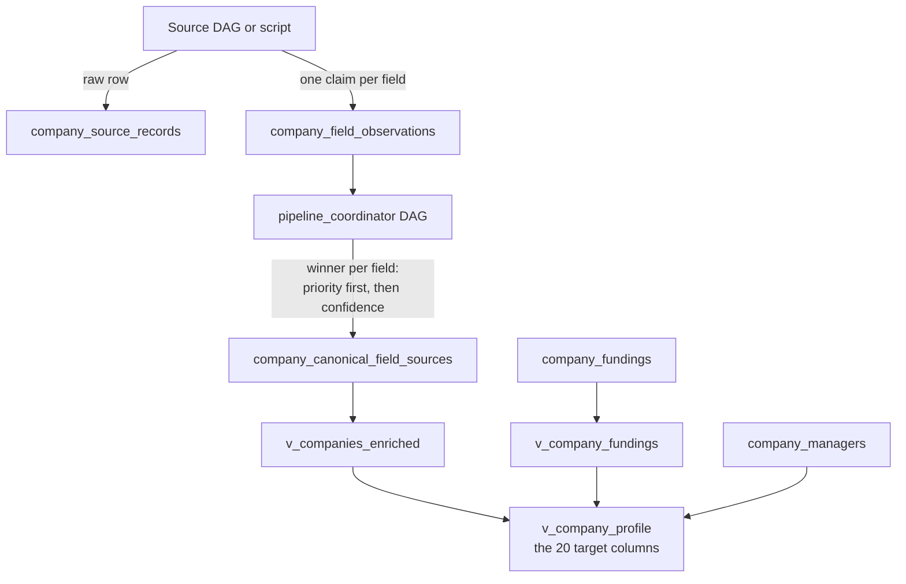

- Priority beats confidence. A source at priority 50 beats every source at priority 100, at any
  confidence. Among equal priorities, confidence decides.
- Observations are never deleted, only replaced as the winner. The old value stays as evidence.

### Database logins (as on the hub)

| Login | Used by | Allowed |
|---|---|---|
| `app` (owner) | Flyway, host scripts | everything, including schema changes |
| `writer` | all Airflow DAGs | read and write rows, temporary tables; no schema changes |
| `reader` | Hasura, so the app | read everything; write comments and votes only |

## 6. Which field comes from which source

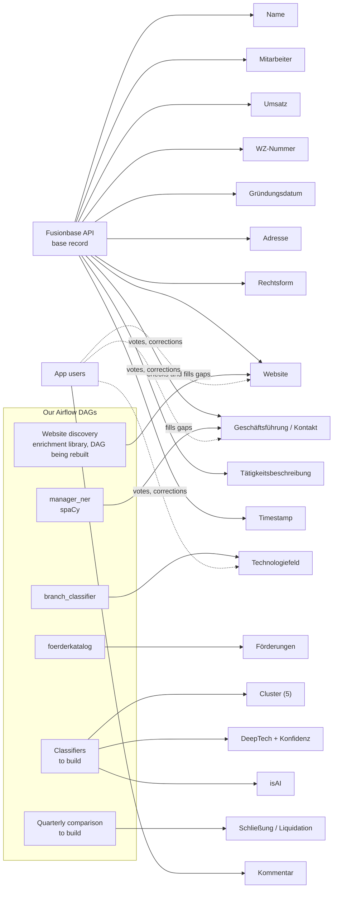

| # | Target column | View column | Base: Fusionbase API | Enrichment: our DAGs | State today (example data) |
|---|---|---|---|---|---|
| 1 | Name | `name` | register name | none | from the example data |
| 2 | Mitarbeiter | `employee_count` | if published in the Bundesanzeiger, with history | fill gaps later | empty |
| 3 | Umsatz | `revenue` | if the company must publish, with history | fill gaps later | empty |
| 4 | Förderungen | `funding_count`, `funding_total_eur` | not delivered | `foerderkatalog` DAG; Land Berlin grants to add | 19,533 federal grants for 3,003 recipients |
| 5 | WZ-Nummer | `wz_code` | produced by Fusionbase's AI | check against the register purpose | from the example data |
| 6 | Gründungsdatum | `established_at` | yes | none | from the example data |
| 7 | Adresse | `address` | yes | none | from the example data |
| 8 | Rechtsform | `legal_form` | yes | none | from the example data |
| 9 | Cluster (n=5) | `cluster` | not delivered | classifier to build | empty in the target; the example values are free text from the search experiments (section 8) |
| 10 | Technologiefeld | `technologiefeld` | not delivered | `branch_classifier` keywords; a text classifier fills rows without a keyword (opt-in) | 403 of 14,443 |
| 11 | Website | `website` | yes | discovery DAGs verify it and fill gaps | 3,529 |
| 12 | Geschäftsführung / Kontakt | `management` | contact optional | `manager_ner` (spaCy) on the Impressum, trained on app votes | names from register and Impressum |
| 13 | Tätigkeitsbeschreibung | `business_purpose` | written by Fusionbase's AI, plus keywords | register purpose as a check | register purpose |
| 14 | Kommentar | `comments` | not delivered | app users | live |
| 15 | DeepTech Klassifikation | `deeptech_class` | not delivered | classifier to build | empty |
| 16 | Konfidenz der Klassifikation | `deeptech_confidence` | not delivered | from the same classifier | empty |
| 17 | isAI | `is_ai` | not delivered | classifier to build | empty |
| 18 | Timestamp | `updated_at` | delivery date | resolver timestamps | filled |
| 19 | Amazon-Effekt (optional) | `amazon_effect` | not delivered | not defined yet | empty |
| 20 | Schließung / Liquidation (optional) | `register_status` | only active companies are delivered | a company missing from the next quarterly delivery is a candidate | register status in the example data |

Proposal: import Fusionbase as a source with a high priority (like the register export today), so
its values win unless a check of ours is configured to override them. Columns 5 and 13 are AI
output from the vendor and are checked like our own.

## 7. Pipelines

| Pipeline | Source | Kind | Priority | Cost | Result on example data |
|---|---|---|---|---|---|
| Fusionbase import | Fusionbase API | DAG, quarterly, to build | high, proposed | contract | none yet |
| OffeneRegister import | Handelsregister snapshot 2017–2019 | scripts, once | register facts | free | 296,486 Berlin companies, full record per company |
| Website discovery: URL patterns, OSM, Impressum and register check | company websites | DAG to rebuild on `enrichment/` (#18) | 100 | free | 552 websites on example data; 106 of 1,000 active Berlin companies |
| `branch_classifier`: 77 technology fields | company websites, register purpose | DAG to rebuild on `enrichment/` (#18) | 100 | free | 27 of 106 Berlin companies with a website |
| `manager_ner`: names from the Impressum | Impressum pages, app votes | DAGs | 100 | free | measured on 222 Impressum pages (section 9) |
| `foerderkatalog` | Förderkatalog des Bundes | DAG, monthly | | free | grants table |
| `pipeline_coordinator` | all of the above | DAG | | free | picks the winning values |

Every DAG is off by default. It needs its `ENABLE_*` flag and must be unpaused in Airflow.

## 8. Experiments on the example data (not part of the target)

These ran only on the Osnabrück example data, to learn what works. **All of them except OSM were
removed from the repo on 2026-10-28** (code, DAGs and docker-compose services); the backup of that
state is outside the repo.

| Experiment | What it did | Measured result | What happens to it |
|---|---|---|---|
| Northdata export | example base data, 14,443 companies; its websites imported at priority 50 | 2,815 canonical websites | removed |
| Brave, Exa and Parallel search | paid web search plus a model that picks the company's site | 85, 39 and 1 canonical websites | removed: paid, used once |
| OpenStreetMap | matches a company to a mapped business with a website | 3 of 1,000 active Berlin companies | kept, in `enrichment/`; to be extended (#18) |
| SearXNG | free local web search for the `llm` stage | found nothing: search engines answer with a CAPTCHA on this network | removed |
| Ollama judge | a local model reads a downloaded page and says whether it is this company's site | 886 high, 56 medium, 1 low among 943 websites | removed: no GPUs on the hub |

## 9. AI and models

### Where which technique is used

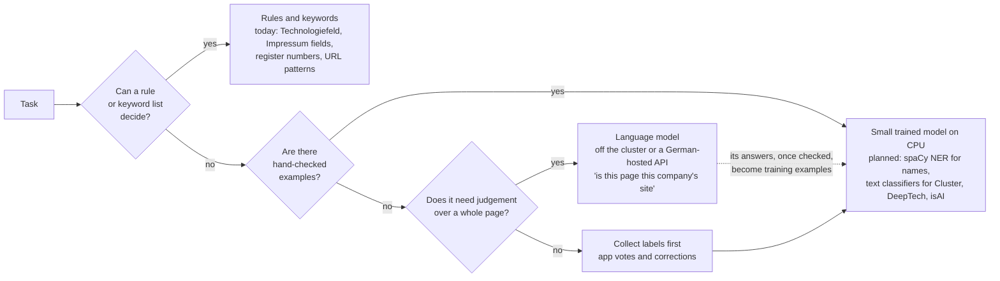

| Task | Technique today | Measured | Next |
|---|---|---|---|
| Technologiefeld, purpose field | keyword weights; a local model only breaks ties; optionally a spaCy text classifier for rows no keyword reached | 403 Technologiefeld values; no precision figure yet | collect votes, train the classifier, compare on human labels |
| Is a page the company's own site | rules: Impressum, register number, company name | 943 websites, with the Ollama judge experiment (section 8) | decide on the judge after comparing with and without it |
| Manager names | regular expressions on the Impressum, plus spaCy (`manager_ner`) since 2026-10-27 | spaCy agreed on 77 of 222 pages and added names on 10; one-word names are now dropped | weekly training from app votes and corrections |
| Pages that need a browser | plain HTTP download | 2 of 229 homepages came back nearly empty, none rendered by JavaScript | repeat on Berlin data |
| Cluster, DeepTech, isAI | none | | labels first, then a text classifier |

### Where spaCy fits, field by field

| Field | spaCy component | Status |
|---|---|---|
| Geschäftsführung (names) | named-entity recognition (persons) next to labels like "Geschäftsführer" | built: `manager_ner_extract` and `manager_ner_train` |
| Kontakt (person, role) | named-entity recognition plus rules for roles | after names work |
| Technologiefeld (gaps) | text classification, seeded by the keyword results and corrected by app votes | built: `scripts/train_branch_textcat.py`, `classify --textcat` |
| Cluster, DeepTech, isAI | text classification on website text and register purpose, same pattern | needs labels first; Cluster may be a lookup from the Technologiefeld |
| Technologiefeld | lemmatising for the keyword matching (inflected forms) | optional improvement; does not split German compounds |
| Matching grants to companies | organisation names (ORG) as a fallback to exact name match | idea |

### When a language model is the right tool

- Judging whether a page belongs to a company, where evidence is spread over a whole page.
- Writing labels for a first training set, which people then check, so that a small model can learn
  from them. The language model teaches once; the small model runs on every company.
- Open questions without a fixed answer list.

Not for fields with a fixed format (register numbers, postcodes, URLs), and never as the only
evidence. The hub has no GPU: model runs happen off the cluster or through a German-hosted model API.

### Other model types worth considering

| Model type | Good for | Cost |
|---|---|---|
| Sentence embeddings (multilingual, CPU) plus a simple classifier | Cluster, DeepTech, isAI with a few hundred labels | low |
| Zero-shot entity recognition (e.g. GLiNER) | extracting fields before any labels exist | low, CPU |
| Fuzzy and learned matching | linking grants and Fusionbase records to companies | low |

## 10. Feedback loop and model training

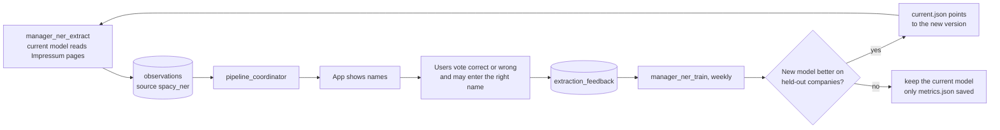

How votes become training data, per company:

| Vote | Meaning for the model |
|---|---|
| most voters say correct | this text is a person name |
| a correction was entered | the corrected text is a person name |
| most voters say wrong | this text is not a person name |
| nobody voted, or a tie | unknown; ignored in training instead of counted as "not a name" |

- Training continues from the model in use (at first the German base model `de_core_news_md`).
- A fifth of the companies is always held out (the same ones every run). The new model is scored
  there against the current model and the regex extractor; only a better F1 score promotes it.
- Every trained version gets a folder with its `metrics.json`; the model files are kept only for a
  promoted version, so a weekly run that changes nothing adds a few kilobytes, not a model.
  `current.json` names the one in use.
- Training starts only with at least 30 companies with usable votes (setting
  `MANAGER_NER_MIN_COMPANIES`); below that the DAG logs the count and stops.
- Votes are possible for manager names, website and Technologiefeld, on the company page and, with
  "Werte bewerten" switched on, in the table. Corrections are entered on the company page.
- Corrections do not change the shown value. Whether they should become a source of their own, at
  which priority, is an open decision.

The Technologiefeld text classifier follows the same loop, run by hand with
`scripts/train_branch_textcat.py`:

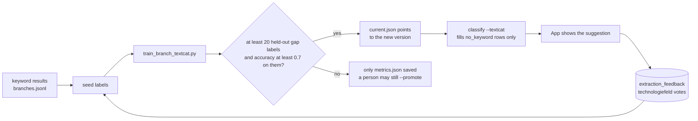

- Keyword rows are the seed. A correction replaces a label; a "wrong" without one removes it.
- It is judged only on held-out gap companies: those no keyword decided, which are the only rows it
  fills. On every other held-out company it mostly repeats its seed, so its accuracy there is
  stored for information and never decides.
- On a gap company a confirmed value or a correction is the label; a "wrong" without a correction
  counts as a miss when it rejects exactly the predicted field, and is ignored on any other value.
- Keywords give nothing in a gap, so the bar is a fixed accuracy (`BRANCH_TEXTCAT_MIN_ACCURACY`,
  0.7) on at least 20 gap labels (`BRANCH_TEXTCAT_MIN_HUMAN_HOLDOUT`), not a tie with the keywords.
- Gap labels come from votes on shown textcat suggestions, which exist only after a person promoted
  a model with `--promote`, or from corrections for `no_keyword` companies, for example taken from
  the `classify-labels` worksheet. Until then nothing is promoted automatically.

## 11. The app

| Feature | Detail |
|---|---|
| Company list | all target fields as columns; name column pinned; server-side sorting by clicking a column header |
| Filters | name, legal form, register status, Technologiefeld, WZ prefix, with website, with grants; all kept in the URL, so a filtered list can be shared as a link |
| Company page | all fields, grants with amounts and periods, comments, votes and corrections |
| Login | Keycloak (OpenID Connect); every request to Hasura carries the user's token |

## 12. Running it locally

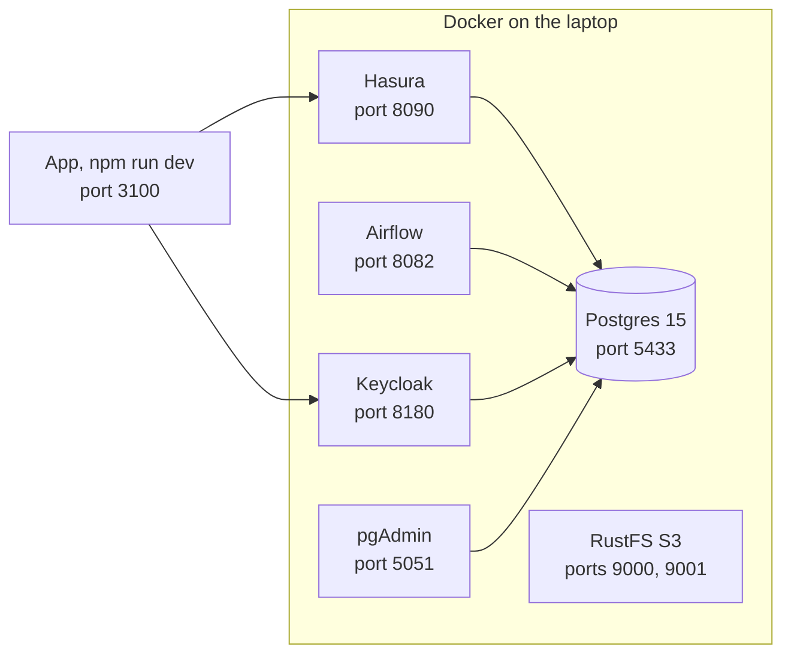

```bash
cd unternehmensdatenbank
cp .env.example .env
./scripts/dev-up.sh                       # Postgres, migrations for staging and prod, Airflow
docker compose --profile datahub up -d    # Keycloak, Hasura, S3

cd ../unternehmensdaten-app
cp .env.example .env.local                # set NEXTAUTH_SECRET
npm install
npm run dev                               # http://localhost:3100
```

| Service | Address | Login (local only) |
|---|---|---|
| App | http://localhost:3100 | dev / dev |
| Airflow | http://localhost:8082 | airflow / airflow |
| Hasura console | http://localhost:8090/console | admin secret local-admin-secret |
| Keycloak admin | http://localhost:8180/admin | admin / admin |
| pgAdmin | http://localhost:5051 | admin@example.com / admin |
| Postgres | localhost:5433 | app, writer or reader (password = name) |
| S3 console | http://localhost:9001 | localaccess / localsecret |

Locally, RustFS stands in for MinIO: MinIO no longer publishes container images, and RustFS speaks
the same S3 API.

## 13. From a commit to the Data Hub

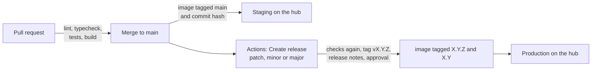

- App images: `ghcr.io/technologiestiftung/unternehmensdaten-app`. No `latest` tag; production is
  pinned to a version. All configuration comes from environment variables (`.env.example`).
  Hand-over list for the hub team: `unternehmensdaten-app/docs/datahub-handover.md`.
- Database: Flyway runs against staging first, then prod. The login names are parameters.
- Hasura: `hasura/metadata/` is applied unchanged; its database connection uses the reader login.
- Airflow: DAGs from the data repo as a DAG bundle. How Python packages get installed (shared image
  or one virtual environment per task, as the hub's own DAGs do) is still open.

## 14. Quality gates

| Gate | What it does | Where |
|---|---|---|
| Claude Code hooks | lint after each edit; checks before each commit; asks before new files, commits and pushes; short commit messages | both repos, `.claude/` |
| Guards and tests | five rule guards, unit tests, and tests that pin the numbers of one reference copy of the example data | data repo |
| CI | lint, typecheck, tests, build on every pull request | app repo |
| no-mistakes (optional) | review, tests, docs, lint, push, pull request, CI in one run | both repos, only where it is installed |

## 15. Data protection

- Manager names and contact details are personal data, also when they come from a public Impressum.
- `extraction_feedback` stores a name, an employee's vote and possibly a typed correction. This is a
  new collection of personal data and needs a privacy review before going live on the hub.
- No names go into prompts for AI tools; measurements report counts only.
- Keys and passwords come from environment variables or secrets, never from images or code.

## 16. Open work

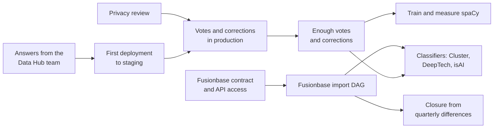

### Decisions and input from others
- [ ] Data Hub team (datahub@ts.berlin): app domain; Keycloak realm; our own Hasura or a source in a
      shared one; DAG name prefix; is ghcr.io allowed; automatic or manual image updates; Airflow
      version and package installation; GPU plans
- [ ] Privacy review for `extraction_feedback` and `company_managers`
- [ ] Definition of "Amazon-Effekt"
- [ ] Fusionbase contract and API access
- [ ] Should user corrections become a source with its own priority

### Build
- [ ] Fusionbase import DAG: base record for every company, quarterly, as a high-priority source; companies missing from a delivery become closure candidates
- [ ] Remove the Northdata example path once Fusionbase is connected
- [ ] Land Berlin grants next to the federal Förderkatalog
- [ ] Classifiers for Cluster (5), DeepTech with confidence, and isAI
- [ ] spaCy: collect at least 30 companies with votes, then run `manager_ner_train` for the first time
- [ ] Model storage on the hub (persistent volume or S3) and an upsert key for `ceo_name_or_contact`, so a better model can re-read all companies
- [ ] Names voted wrong stay in `company_managers`: the resolver only adds names, it never removes one
- [ ] Employee count and revenue where Fusionbase leaves gaps
- [ ] Checkpoints and the page cache out of local files (the hub's Airflow has no shared disk)
- [ ] Page cache bug: 39 of 268 websites found by URL pattern have no cached homepage

### Tidy up
- [ ] Newline gap in the data repo's commit and push hooks (already fixed in the app repo)
- [ ] Align local Airflow 3.2 with the hub's version (the add-on defaults to 3.3; unconfirmed)
- [ ] Repeat the crawler measurement on Berlin data

## 17. Glossary

| Term | Meaning |
|---|---|
| Observation | one claim by one source about one field of one company |
| Canonical value | the observation that won for a field |
| Priority | rank of a source; the lower number wins, before confidence |
| Technologiefeld | one of Berlin's 77 technology fields, derived from website text |
| WZ | the German industry classification (Wirtschaftszweige), WZ 2025 |
| FKZ | Förderkennzeichen, the identifier of one grant |
| DAG | one Airflow pipeline |
| Data Hub | Berlin's urban data platform, CIVITAS/CORE on Kubernetes |
