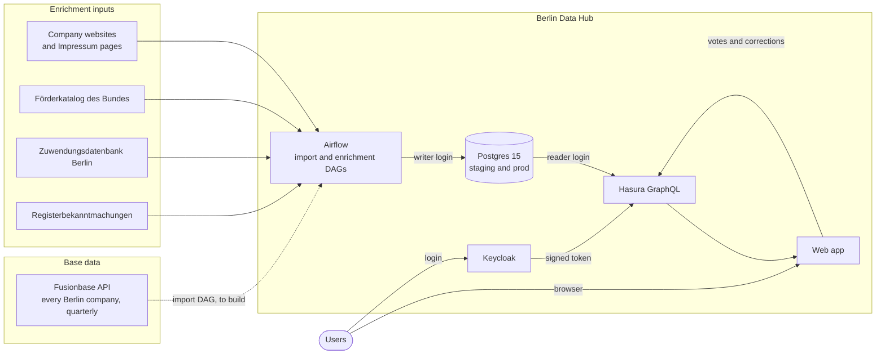
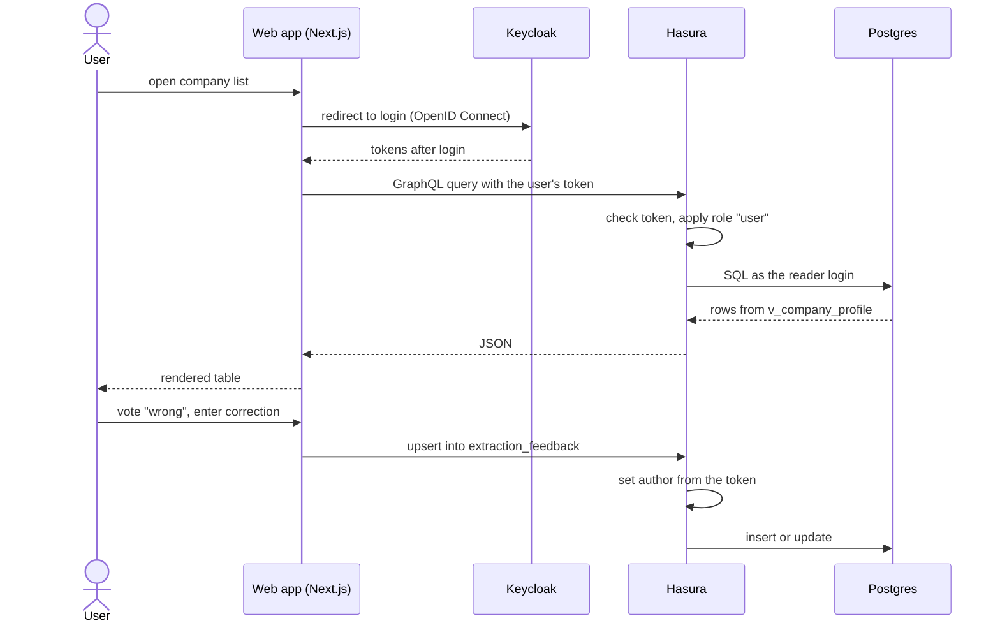
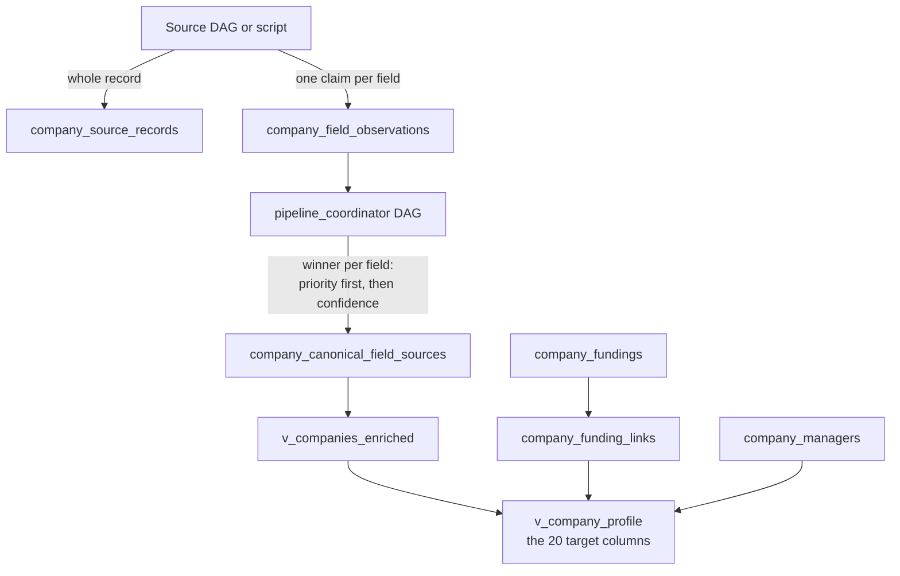
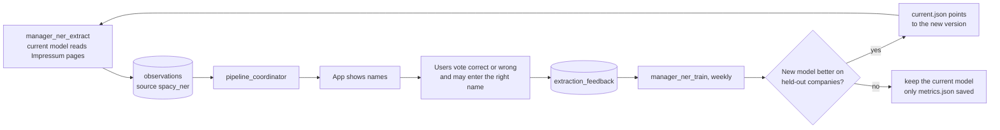

# Unternehmensdatenbank: Architecture Overview

> State on 2026-10-29. Target: the **Fusionbase API** delivers the base record of every Berlin
> company, and our **Airflow DAGs** enrich it. Fusionbase is not connected yet; until it is, the
> example data is **296,486 Berlin companies from OffeneRegister** (a Handelsregister snapshot from
> 2017–2019). Next steps: issue #18.

## 1. Goal

One record per Berlin company with 20 target columns, filled cheaply and traceably: for every value
we know which source said it and why it won over the others.

It runs on the **Berlin Data Hub** (data-hub.berlin), a Kubernetes platform built on CIVITAS/CORE.
We do not deploy there ourselves: we hand over container images, DAGs, migrations and
configuration, and the hub team runs them. Locally, `docker-compose.yml` emulates the hub
([datahub-emulation](datahub-emulation.md)).

## 2. System context

Fusionbase answers "which companies exist and what is registered about them". Our DAGs add what it
does not deliver (grants, Technologiefeld, classifications) and check what it does (websites,
AI-written WZ codes and descriptions). The app's users are a source too: votes, corrections and
comments. Dashed lines are planned.

## 3. Repositories and who runs what

| Piece | Lives in | Runs on |
|---|---|---|
| Database schema (`db/migrations/`, V1 baseline + V2) | this repo | hub Postgres, via the migration image |
| Pipelines (`airflow/dags/`, `scripts/`) | this repo | hub Airflow; every task a pod from our pipelines image |
| GraphQL API and permissions (`hasura/metadata/`) | this repo | hub Hasura |
| Login realm, local reference (`keycloak/`) | this repo | hub Keycloak |
| Web app | `technologiestiftung/unternehmensdaten-app` | hub, as an image from GHCR |

How images are built and released: [release](release.md).

## 4. How a page request works

The app has no database access of its own. Every read and write goes through Hasura. The author of a
comment or vote always comes from the login token, never from the browser.

## 5. Data model

Tables, views and migrations in detail: [data-model](data-model.md).

- **Priority beats confidence.** A source at priority 50 beats every source at priority 100, at any
  confidence. Among equal priorities, confidence decides.
- Observations are never deleted, only replaced as the winner. The old value stays as evidence.
- Grants have no company id: the Förderkatalog has no register number. `company_funding_links`
  links them by register number where the grant names one, otherwise by normalised name and city
  when exactly one company matches. An ambiguous name links to nobody.

### Database logins (as on the hub)

| Login | Used by | Allowed |
|---|---|---|
| `app` (owner) | Flyway, host scripts | everything, including schema changes |
| `writer` | all Airflow DAGs | read and write rows, temporary tables; no schema changes |
| `reader` | Hasura, so the app | read everything; write comments and votes only |

## 6. Which field comes from which source

| # | Target column | View column | Base: Fusionbase | Enrichment: our DAGs | State today (example data) |
|---|---|---|---|---|---|
| 1 | Name | `name` | register name | none | from OffeneRegister |
| 2 | Mitarbeiter | `employee_count` | if published in the Bundesanzeiger, with history | fill gaps later | empty |
| 3 | Umsatz | `revenue` | if the company must publish, with history | fill gaps later | empty |
| 4 | Förderungen | `funding_count`, `funding_total_eur` | not delivered | `foerderkatalog`, `berlin_zuwendungen` | 5,189 companies with a grant (26,236 of 41,896 grants linked) |
| 5 | WZ-Nummer | `wz_code` | produced by Fusionbase's AI | check against the register purpose | empty: OffeneRegister has none |
| 6 | Gründungsdatum | `established_at` | yes | none | empty: OffeneRegister has none |
| 7 | Adresse | `address` | yes | none | 116,527 of 296,897 |
| 8 | Rechtsform | `legal_form` | yes | none | 257,244 of 296,897 |
| 9 | Cluster (n=5) | — | not delivered | column removed with #47 (it held LLM free text, not Berlin's five clusters); back as a new column once a classifier exists | — |
| 10 | Technologiefeld | `technology_field` (English names) | not delivered | keywords on the website text; DAG `technology_field` (#62) | 27 of 106 Berlin companies with a website, measured |
| 11 | Website | `website` | yes | `website_discovery`, `wikidata` and `common_crawl` verify and fill gaps | 4,929 (106 among the first 1,000 active companies checked) |
| 12 | Geschäftsführung / Kontakt | `management` | contact optional | register Geschäftsführer (`import_register_managers.py`); `manager_ner` (spaCy) on the Impressum; `website_contacts` for email and phone | names from register and Impressum; email and phone stored, not shown |
| 13 | Tätigkeitsbeschreibung | `business_purpose`, `activity_keywords` | written by Fusionbase's AI | `website_keywords` | keywords published once 500 companies are read |
| 14 | Kommentar | `comments` | not delivered | app users | live |
| 15 | DeepTech Klassifikation | `deeptech_class` | not delivered | classifier to build | empty |
| 16 | Konfidenz der Klassifikation | `deeptech_confidence` | not delivered | same classifier | empty |
| 17 | isAI | `is_ai` | not delivered | classifier to build | empty |
| 18 | Timestamp | `updated_at` | delivery date | resolver timestamps | filled |
| 19 | Amazon-Effekt (optional) | — | not delivered | column removed with #47, meaning not defined yet | — |
| 20 | Schließung / Liquidation (optional) | `register_status`, `register_announcement` | only active companies are delivered | `register_announcements` (weekly, a hint); a company missing from the next delivery is a candidate | register status; announcements for 854 companies |

Proposal: import Fusionbase as a high-priority source, so its values win unless a check of ours is
configured to override them. Columns 5 and 13 are vendor AI output and are checked like our own.

## 7. Pipelines

| Pipeline | Source | Kind | Result on example data |
|---|---|---|---|
| Fusionbase import | Fusionbase API | DAG, quarterly, to build | none yet |
| OffeneRegister import | Handelsregister snapshot 2017–2019 | scripts, once | 296,486 Berlin companies |
| `website_discovery` | URL patterns, Impressum and register check | DAG, priority 100 | 4,929 websites |
| `wikidata` | official websites (P856) Wikidata lists for Berlin organisations, verified like a guessed domain | DAG, daily | 229 websites proven for 531 matched companies (local copy, 2026-10-30) |
| `common_crawl` | Impressum pages in the Common Crawl that name a Berlin register number, verified like a guessed domain | DAG, weekly | pilot: 21 websites proven from 5,000 Impressum pages (#56) |
| `website_contacts` | Impressum of the proven website | DAG | 27 emails, 25 phones from 37 websites; not shown |
| `website_keywords` | services/products pages of the proven website | DAG | 22 of 37 websites gave candidates |
| `manager_ner_extract` / `_train` | Impressum pages, app votes | DAGs, spaCy | measured on 222 Impressum pages |
| `foerderkatalog` | Förderkatalog des Bundes | DAG, monthly | grants table |
| `berlin_zuwendungen` | Zuwendungsdatenbank Berlin | DAG, monthly | 18,436 grants to 3,868 companies |
| `register_announcements` | handelsregister.de | DAG, weekly | 900 announcements in 8 weeks; 411 companies created |
| `handelsregister_lookup` | handelsregister.de search, one company per query (#66) | DAG, started by hand only, ≤50 an hour | name, seat, status of 2 test companies (2026-10-31) |
| `feedback_observations` | corrections typed in the app | DAG, hourly, priority 50 | shown once two people agree |
| `pipeline_coordinator` | all of the above | DAG | picks the winning values |
| Technologiefeld | website text | DAG `technology_field` (#62) | none |

Every DAG starts paused; unpausing it in Airflow is the only switch.
Details per DAG: [airflow/dags/README.md](../airflow/dags/README.md).

## 8. AI and models

Rules first, small CPU models second, a language model only where judgement over a whole page is
needed. The hub has no GPU.

| Task | Technique today | Next |
|---|---|---|
| Technologiefeld, purpose field | keyword weights; a spaCy text classifier only fills rows no keyword reached (`enrichment/branch_textcat.py`) | keywords run as DAG `technology_field`; the text classifier is trained weekly (`technology_field_train`), promoted only on held-out companies people judged (none yet) |
| Is a page the company's own site | rules: Impressum, register number, name and postcode ([website-verification](website-verification.md)) | |
| Manager names | regular expressions on the Impressum, plus spaCy (`manager_ner`) | weekly training from votes |
| Cluster, DeepTech, isAI | none | labels first, then a text classifier |

A language model is never the only evidence and never used for fields with a fixed format (register
numbers, postcodes, URLs). Its checked answers can become training labels for a small model.

## 9. Feedback loop: training `manager_ner`

| Vote | Meaning for the model |
|---|---|
| most voters say correct | this text is a person name |
| a correction was entered | the corrected text is a person name |
| most voters say wrong | this text is not a person name |
| nobody voted, or a tie | unknown; ignored in training |

- Training continues from the model in use (at first `de_core_news_md`).
- A fifth of the companies is always held out (the same ones every run); only a better F1 score
  there promotes a new model.
- Training starts only with at least 30 companies with usable votes (`MANAGER_NER_MIN_COMPANIES`).
- Corrections do not change the shown value. Whether they become a source of their own is open.

## 10. The app

| Feature | Detail |
|---|---|
| Company list | all target fields as columns; server-side sorting |
| Filters | name, legal form, register status, Technologiefeld, WZ prefix, with website, with grants; kept in the URL |
| Company page | all fields, grants, comments, votes and corrections |
| Sources page (`/sources`) | per source: records, companies, values stored and shown, latest run |
| Login | Keycloak (OpenID Connect); every request to Hasura carries the user's token |

Running everything locally: [README](../README.md).

## 11. Open work

- Data Hub team (datahub@ts.berlin): app domain, Keycloak realm, own or shared Hasura, who applies
  the Hasura metadata, DAG name prefix, Airflow version.
- Fusionbase contract, API access, then its import DAG; closure candidates from quarterly
  differences.
- Classifiers for Cluster, DeepTech with confidence, and isAI.
- Hand-check about 200 Technologiefeld values in the app (corrections count as labels); the text classifier cannot be promoted before people judged companies the keywords left empty.
- First `manager_ner_train` run once 30 companies have votes.
- Should user corrections become a source; definition of "Amazon-Effekt".

## 12. Glossary

| Term | Meaning |
|---|---|
| Observation | one claim by one source about one field of one company |
| Canonical value | the observation that won for a field |
| Priority | rank of a source; the lower number wins, before confidence |
| Technologiefeld | one of Berlin's 77 technology fields, derived from website text |
| WZ | the German industry classification (Wirtschaftszweige) |
| FKZ | Förderkennzeichen, the identifier of one grant |
| DAG | one Airflow pipeline |
| Data Hub | Berlin's urban data platform, CIVITAS/CORE on Kubernetes |
